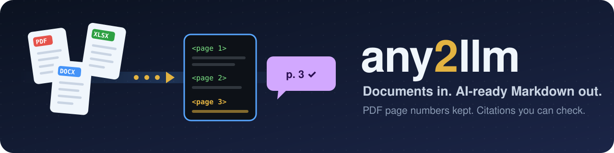

<div align="center">



### Ask AI about your documents and see the exact page each answer came from.

PDF · Word · PowerPoint · Excel · EPUB · HTML · code → Markdown for ChatGPT, Claude, Gemini, local LLMs, and MCP apps

[**Quick start**](#-quick-start) · [**Try it in 60 seconds**](#-try-it-in-60-seconds-no-install) · [**Claude & Cursor (MCP)**](#-use-it-in-claude-cursor-and-other-mcp-apps) · [**Docs**](docs/SPEC.md) · [**Türkçe**](README.tr.md)

[](https://pypi.org/project/any2llm/)
[](pyproject.toml)
[](https://registry.modelcontextprotocol.io/v0/servers?search=io.github.ahmetemreapo/any2llm)
[](https://github.com/ahmetemreapo/any2llm/actions/workflows/platforms.yml)
[](LICENSE)


</div>

## 🤔 Why any2llm?

AI chats read documents well, until you need to check an answer. *Which page said that? Was the scanned page even read?* Most converters drop page numbers, so the chat can’t cite them and you can’t verify them.

any2llm packs a whole folder into Markdown that keeps **every PDF page number**, flags pages it **couldn’t read**, and writes the prompt that asks the AI to **cite its sources**.

- 📑 **Citations you can check.** Each PDF fragment sits in a `<page number="3">` tag. The AI cites the page and you open the original.
- 🗂️ **Mixed folders in one go.** PDF, Word, PowerPoint, Excel (values *and* formulas), EPUB, HTML, CSV, Markdown, and source code.
- ✂️ **Fits any context window.** Token-budgeted batches plus a prompt that walks the chat through them in order.
- 🔌 **Works everywhere.** Attach it in any chat, pipe it into any CLI, or connect Claude and Cursor through MCP.
- 🔒 **Local and careful.** Everything runs on your computer. Credential files are skipped and likely secrets flagged. Broken, encrypted, or binary files are reported instead of crashing the run.
- 🌍 **11 languages** for the terminal and the generated prompts.

## 🚀 Quick start

**1. Run it.** With [uv](https://docs.astral.sh/uv/getting-started/installation/) there’s nothing to install:

```sh
uvx any2llm ./my-documents
```

<sub>Prefer a permanent install? `pipx install any2llm` (Python 3.11+). [Installation help for Windows, macOS, and Linux](docs/install.md)</sub>

**2. Pick your files.** All readable files start checked. Press Enter to continue.

**3. Chat.** Attach the numbered `.md` files from `_llm_pack/` and paste the prompt that’s already on your clipboard. Then check the cited pages.

### Choose your workflow

| | You run | You get |
| --- | --- | --- |
| 💬 **Any AI chat** | `any2llm ./docs` | Numbered Markdown attachments and a citation prompt on your clipboard |
| 🔌 **Claude, Cursor & MCP apps** | `claude mcp add any2llm -- uvx any2llm mcp ~/Documents` | The AI reads your folder itself, on request |
| 🧰 **Scripts and pipes** | `any2llm ./docs --stdout \| llm "List every deadline"` | One Markdown stream on standard output |

## 🧪 Try it in 60 seconds (no install)

Real output files are checked into this repo. Attach one to your favorite AI chat and see the page citations for yourself.

> [!TIP]
> If GitHub opens the attachment as text, use the download arrow (↓) at the top of the file view to save the original `.md` file.

### 💼 Work example: delivery dates

A supplier offer (PDF), a delivery schedule (Excel), and a meeting note (text). [Browse the source files](examples/delivery-dates/).

1. Download the [delivery dates attachment](examples/delivery-dates-pack/batch_01_of_1.md?plain=1) with **↓** and attach it in your AI chat.
2. Send this question with it:

   > List the pilot and main shipment dates. Cite the Excel sheet and the original PDF page for each date, and flag any page whose text could not be read.

3. Check pages 1 and 3 of the [original supplier offer](https://raw.githubusercontent.com/ahmetemreapo/any2llm/main/examples/delivery-dates/supplier-offer.pdf#page=1).

<details>
<summary><b>Expected answer</b></summary>

| Shipment | Delivery date | Sources |
| --- | --- | --- |
| Pilot | March 12, 2027 | `delivery-schedule.xlsx`, **Schedule** sheet, and `supplier-offer.pdf`, **page 1** |
| Main | March 26, 2027 | `delivery-schedule.xlsx`, **Schedule** sheet, and `supplier-offer.pdf`, **page 3** |

The batch flags page 2 because its text is in an image. Open the original page to read the freight note.

</details>

### 🎓 Student example: midterm practice

Four research methods files (PDF, PowerPoint, Word, and Excel) in one attachment, plus [the generated chat prompt](examples/midterm/en/PROMPT.txt).

1. Download the [midterm attachment](examples/midterm/en/batch_01_of_1.md?plain=1) with **↓** and attach it in your AI chat.
2. Send this question with it:

   > Which research design fits the measurement plan? Cite the Excel sheet for what was measured in each class and the original PDF page for the design definition.

3. Check the definition on [page 2 of the original PDF](https://raw.githubusercontent.com/ahmetemreapo/any2llm/main/src/any2llm/demo_assets/en/research-designs.pdf#page=2).

<details>
<summary><b>Expected answer</b></summary>

The plan uses a **quasi-experimental pretest–posttest design with a nonequivalent comparison group**. Two existing classes take the same 10-item terms test before and after the activity, with no random assignment. Class A recalls the terms from memory and Class B rereads them, each for eight minutes. See the **Plan** sheet in `measurement-plan.xlsx` and **page 2** of `research-designs.pdf`.

</details>

Run the same demo locally with `any2llm demo --lang en --no-open`.

## 👥 Who is it for?

| If you work with… | Try this |
| --- | --- |
| 💼 Office and finance records | Reconcile dates in a supplier offer and a spreadsheet. |
| ⚖️ Legal documents | Compare clauses across contract drafts and check the quoted wording in the original PDF. |
| 🔬 Research material | Summarize methods across papers and check a definition against its source page. |
| 🎓 Course material | Turn lecture slides, readings, and a worksheet into practice questions. |
| 📚 Books and long reads | Pack an EPUB or saved web pages and ask for a chapter-by-chapter summary. |
| 💻 Software and docs | Ask how a setting is used across source files and technical notes. |

## 💬 Use it with any AI chat

```sh
any2llm "./documents"          # keep the quotes if the path has spaces
any2llm ./documents -r         # include subfolders
any2llm ./documents --task "Find every payment deadline and who owes it"
```

1. On the first run, choose your language, a detail level, and whether to open the output folder.
2. Select files, then attach the numbered Markdown files from `_llm_pack/` and paste the prompt (also saved as `PROMPT.txt`).
3. If there are several batches, follow the upload order the terminal prints and send the continuation word between them in the same chat.

> [!NOTE]
> Models don’t always follow multi-batch instructions. If one doesn’t move on, resend your last message and name the next batch. Check important citations against the original.

## 🔌 Use it in Claude, Cursor, and other MCP apps

`any2llm mcp` runs a local [Model Context Protocol](https://modelcontextprotocol.io) server. The AI gets two read-only tools: `list_documents` shows what a folder contains, and `read_documents` returns Markdown with PDF page tags, in batches when the content is large. The server never reads outside the folder you give it.

**Claude Code**

```sh
claude mcp add any2llm -- uvx any2llm mcp ~/Documents
```

<details>
<summary><b>Claude Desktop, Cursor, Windsurf, and other apps with an <code>mcpServers</code> file</b></summary>

```json
{
  "mcpServers": {
    "any2llm": {
      "command": "uvx",
      "args": ["any2llm", "mcp", "/Users/you/Documents"]
    }
  }
}
```

If the app can’t find `uvx`, use its full path (`which uvx` on macOS and Linux, `where uvx` on Windows). With a pipx install, use `"command": "any2llm"` and `"args": ["mcp", "/Users/you/Documents"]`. Add `--ocr` or `--ocr-lang tur` after the folder to read scanned pages.

</details>

Then just ask: *“Read the contracts folder and list each termination clause with its PDF page.”*

## 🧰 Use it in scripts and pipes

`--stdout` prints one unsplit pack to standard output and sends progress and warnings to standard error. It selects every readable file and writes nothing to disk.

```sh
any2llm ./contracts --stdout | claude -p "Which contract renews automatically? Cite the PDF page."
any2llm ./papers -r --stdout | llm "Compare the sample sizes across these papers"
any2llm ./notes --stdout | pbcopy        # macOS (Linux: wl-copy or xclip, Windows: clip)
any2llm ./notes --stdout > notes-pack.md
```

<details>
<summary><b>All command-line options</b></summary>

| Option | Effect |
| --- | --- |
| `-r`, `--recursive` | Include subfolders |
| `-y`, `--yes` | Select every readable file without prompting |
| `--stdout` | Print one unsplit pack to standard output |
| `--task TEXT` | Put your question into the generated prompt |
| `--max-tokens INT` | Token budget per batch |
| `--lang CODE` | Terminal and prompt language: `en`, `zh`, `hi`, `es`, `fr`, `ar`, `bn`, `pt`, `ru`, `ur`, `tr` |
| `--ocr`, `--ocr-lang LANG` | OCR PDF pages without extractable text (for example `eng+tur`) |
| `--exclude GLOB` | Skip matching paths (repeatable). Root `.gitignore` rules also apply. |
| `-o DIR`, `--output DIR` | Output folder (default `_llm_pack`) |
| `--details` | List every skipped file |
| `--plain` | Numbered menus instead of checkboxes |
| `--no-open` | Don’t open the output folder |
| `--include-sensitive` | Include files that look like credentials |
| `setup`, `demo`, `mcp [DIR]` | Change settings, run the demo, or start the MCP server |

Full reference: [docs/SPEC.md](docs/SPEC.md#command-line-options)

</details>

## 📄 What gets extracted

| Format | What you get |
| --- | --- |
| **PDF** | Text per physical page in `<page>` tags. Pages without text are flagged, and optional OCR can read them. |
| **Word** (`.docx`) | Paragraphs and tables in document order |
| **PowerPoint** (`.pptx`) | Text and tables, slide by slide |
| **Excel** (`.xlsx`) | Visible sheets as tables, with cached values *and* formulas |
| **EPUB** | Chapters in reading order. DRM-protected books are skipped. |
| **HTML** | Saved pages as readable text with headings, lists, and tables. Templates stay as code. |
| **Text and code** | Markdown, CSV, JSON, YAML, and source code, with whitespace preserved |

Charts, images, and page layout aren’t extracted. Check the original when an answer depends on a visual.

## ⚖️ How is it different?

Of the tools below, only any2llm keeps PDF page numbers *inside* the chat attachments and writes a prompt that asks for citations and guides multi-batch chats.

| Tool | PDF page numbers | Output splitting | OCR | Chat instructions |
| --- | --- | --- | --- | --- |
| **any2llm** | ✅ Page tags in Markdown | ✅ Token-budgeted batches | Optional local Tesseract | ✅ Citation prompt and continuation messages |
| MarkItDown | — | — | Vision model via plugin | — |
| Docling | In document provenance | JSONL chunks by token budget | Configurable engines | — |
| Pandoc | — | Section-based HTML chunks | — | — |
| Repomix | — | Numbered files by size | — | User-written instructions file |

<details>
<summary>Sources</summary>

A dash marks a feature these sources don’t describe.

- MarkItDown ([README](https://github.com/microsoft/markitdown/blob/main/README.md), [OCR plugin](https://github.com/microsoft/markitdown/tree/main/packages/markitdown-ocr))
- Docling ([formats and chunks](https://docling-project.github.io/docling/usage/supported_formats/), [page provenance](https://docling-project.github.io/docling/reference/docling_document/#docling_core.types.doc.ProvenanceItem), [OCR engines](https://docling-project.github.io/docling/getting_started/installation/#ocr-engines))
- Pandoc ([input formats](https://pandoc.org/MANUAL.html#option--from), [chunked HTML](https://pandoc.org/MANUAL.html#chunked-html))
- Repomix ([quick start](https://repomix.com/guide/), [output splitting](https://repomix.com/guide/configuration), [custom instructions](https://repomix.com/guide/custom-instructions))

</details>

## 🔒 Privacy, limits, and OCR

- **Privacy.** Extraction and OCR run locally. tiktoken may download its vocabulary on first use. Common credential files (`*.pem`, `id_rsa`, `credentials*`, …) are skipped, and likely secrets in extracted text are flagged but left in the output, so review it before uploading. See the [security policy](SECURITY.md).
- **Limits.** Up to 32 MiB per file, 500 pages per PDF, 128 MiB uncompressed per Office or EPUB archive, and 120 seconds of extraction per file. Your chat’s attachment and context limits still apply.

<details>
<summary><b>Set up OCR for scanned PDFs</b></summary>

Install Poppler (`pdftoppm`) and [Tesseract](https://tesseract-ocr.github.io/tessdoc/Installation.html) with the language data you need, and add their folders to `PATH` as absolute paths. Use `--ocr` for English or `--ocr-lang` to choose installed languages, for example `--ocr-lang eng+tur`. OCR only runs on PDF pages without usable text, and recognized pages are marked in the batch. Check important names and numbers against the scan.

</details>

## 🤝 Contributing

Bug reports, examples, translations, and code are all welcome. Start with the [contributing guide](CONTRIBUTING.md) or an issue labeled [good first issue](https://github.com/ahmetemreapo/any2llm/labels/good%20first%20issue).

If any2llm saved you time, a ⭐ helps other people find it.

## 📜 License

[MIT](LICENSE)
