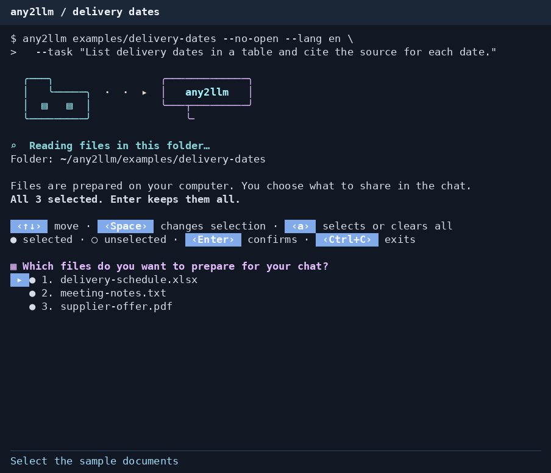

# any2llm

English · [Türkçe kullanım rehberi](README.tr.md)

Turn your documents into fewer files to attach to an AI chat and check answers against the original PDF pages.

**Midterm practice · 4 source files → 1 chat attachment**

## Try it without installing anything

1. **[Download the sample pack](https://raw.githubusercontent.com/ahmetemreapo/any2llm/refs/heads/main/examples/midterm/en/batch_01_of_1.md)** and use the paperclip or + button in your AI chat to attach `batch_01_of_1.md`. If the link opens as text, press and hold the link to save it or use the download arrow (↓) in the [GitHub preview](examples/midterm/en/batch_01_of_1.md?plain=1).
2. **Paste this question into the chat** and send it with the attachment.

   > Which research design fits the measurement plan? Cite the Excel sheet for what was measured in each class and the original PDF page for the design definition.

3. **Check the answer in the [original PDF, page 2 of 2](https://raw.githubusercontent.com/ahmetemreapo/any2llm/refs/heads/main/src/any2llm/demo_assets/en/research-designs.pdf#page=2).** If the PDF opens on page 1, scroll to page 2.

<details>
<summary>Expected answer</summary>

The plan uses a **quasi-experimental pretest–posttest design with a nonequivalent comparison group**. Both existing classes take the same 10-item terms test before and after the activity, with no random assignment. Class A recalls the terms from memory and Class B rereads them, each for eight minutes ([measurement-plan.xlsx](src/any2llm/demo_assets/en/measurement-plan.xlsx), **Plan** sheet). That matches the definition in `research-designs.pdf`, **page 2**.

</details>

The pack contains four original practice documents for the same research methods course. They include a [PDF reading](src/any2llm/demo_assets/en/research-designs.pdf), [PowerPoint slides](src/any2llm/demo_assets/en/measurement-and-bias.pptx), a [Word checklist](src/any2llm/demo_assets/en/study-checklist.docx), and an [Excel measurement plan](src/any2llm/demo_assets/en/measurement-plan.xlsx). The question above is sufficient for this tryout. The CLI also generates [`PROMPT.txt`](examples/midterm/en/PROMPT.txt) with full chat instructions.

any2llm prepares files on your computer. You upload the prepared files to the chat service you choose. Fewer attachments help with file-count limits. The model’s context limit still applies.

[](https://github.com/ahmetemreapo/any2llm/actions/workflows/platforms.yml)

## Install and run the bundled demo

With Python 3.11 or newer, Git, and [pipx](https://pipx.pypa.io/stable/how-to/install-pipx.html) installed, install from the repository’s `main` branch.

```sh
pipx install git+https://github.com/ahmetemreapo/any2llm.git@main
```

If your terminal can't find `any2llm`, run `pipx ensurepath` and open a new terminal. See [installing from a local source folder](#install-from-this-source-folder) for a venv option. The GitHub `v0.1.0` release predates the bundled demo.

```sh
any2llm demo --lang en
```

The command uses the included practice documents and creates a fresh `any2llm-demo-en-*` folder in your current directory on each run. The terminal prints the full path and tells you which file to attach and which text to paste. Use `any2llm ./demo` if you have a folder named `demo` that you want to scan.

To reproduce the exact files linked above in a fresh folder, run the following command from any directory.

```sh
any2llm demo --lang en --no-open -o ./midterm-pack-en
```

## Prepare your own files

Use the path to your folder in place of `./lectures`. Quote paths that contain spaces.

```sh
any2llm ./lectures
```

1. **Open your folder.** Run `any2llm <folder>`, or open a terminal inside your documents folder and run `any2llm`.
2. **Set your preferences.** On first use, choose a language, how to group the documents, and whether to open the output folder automatically. The wizard starts in your system language if supported and uses English otherwise.
3. **Select files.** Press Enter to keep all candidates or use the arrow keys and Space to toggle individual files. Use `--plain` for numbered choices or `-r` to include subfolders. any2llm reads the selected files and reports any it cannot use.
4. **Attach and send.** The terminal shows the path, count, and combined size of the `batch_*.md` files. Attach as many as your chat allows, starting with the first. Paste the instructions from the clipboard or copy them from `PROMPT.txt`.
5. **Continue through the batches.** After each reply, send the continuation word shown in the terminal. Attach the next batch if you haven't uploaded it yet.

- **Output folder.** The default is `_llm_pack` inside your documents folder. Use `-o chat_files` for a different destination, including when existing output cannot safely be replaced.
- **Headless sessions.** Use `--no-open` over SSH, in containers, or on servers.
- **Token budget.** Use `--max-tokens` to cap each batch. The terminal shows whether counts came from `cl100k_base` or an estimate of one token per four characters. Your chat service may count differently.

## Languages

The terminal and generated chat instructions support **11 languages**.

- English (`en`), Simplified Chinese (`zh`), Hindi (`hi`), Spanish (`es`), French (`fr`), Arabic (`ar`)
- Bengali (`bn`), Portuguese (`pt`), Russian (`ru`), Urdu (`ur`), Turkish (`tr`)

Run `any2llm setup` to save a language or use `--lang CODE` for one run. Use a terminal with right-to-left support for Arabic and Urdu, or use `--plain` for numbered menus.

## Privacy and security

- **Local processing.** Document extraction and OCR run on your machine. You upload the files you choose to your chat service.
- **Token counting.** tiktoken can download its token vocabulary if it is missing from the cache.
- **Credential warnings.** The CLI checks extracted text locally for common API key, access token, and private key formats. It shows the filename and finding type and keeps the extracted text in the output. Review every `batch_*.md` file before uploading, even if you see no warning.

See the [security policy](SECURITY.md) to report a vulnerability.

## What gets included

| Source | What the batch keeps |
| --- | --- |
| PDF | Extracted text and physical page numbers. Pages with missing or partial text are marked in the batch. The terminal tells you which original pages to check. PDFs with no usable text are skipped. |
| Word and PowerPoint | Word paragraphs and tables, plus slide text and tables. |
| Excel | Cell values or formulas. |
| Text and code | Source text, including HTML with CSS and JavaScript. |

- **Scan filters.** Images, audio, video, and common environment and build directories are skipped. The scan uses simple rules from the root `.gitignore`. Add quoted patterns with `--exclude '*.log' --exclude 'private/'`.
- **Sensitive filenames.** Files such as `credentials.json`, `id_rsa`, and `server.pem` are skipped by default. Use `--include-sensitive` to let them through the filename filter.
- **Automatic selection.** Use `-y` to select all candidates that pass the scan filters. Without an interactive terminal, it uses saved settings or temporary defaults.
- **Skip details.** Use `--details` for the full list of reported skips and `--help` for all options.

### Extraction limits

| Limit | Maximum |
| --- | --- |
| Source file size | 32 MiB per file |
| PDF length | 500 pages per PDF |
| Uncompressed Office archive size | 128 MiB per Word, PowerPoint, or Excel archive |
| Extraction time | 120 seconds per selected file, including OCR |

Files that exceed a limit are skipped. Your chat service sets its own upload limits.

The pack preserves extracted text and readable tables. Figures, charts, and images embedded in documents can be missing, even when the surrounding text was extracted successfully. any2llm cannot reliably detect these omissions. Open the original document when the answer depends on a visual.

### OCR for scanned PDFs

- **Tools.** Install Poppler (`pdftoppm`) and Tesseract with the language data you need. Add their installation directories to `PATH` using absolute paths. any2llm skips the current working directory when looking for these tools. [Tesseract installation guide](https://tesseract-ocr.github.io/tessdoc/Installation.html)
- **Language.** `--ocr` uses English (`eng`). Use `--ocr-lang` to choose one or more installed languages independently of the terminal language. Run `tesseract --list-langs` to see which languages are available.
- **Pages and results.** OCR runs locally on PDF pages where text extraction found no usable text. The batch keeps the original page number and marks recognized text with `extraction="ocr"`. The terminal lists pages that still have no usable text. Check important names and numbers against the original page.
- **Text recovery.** Poppler's `pdftotext` can repair damaged PDF text with or without OCR, using the same `PATH` rules.

```sh
any2llm ./lectures --ocr
any2llm ./lectures --ocr-lang tur+eng
```

## Smaller technical example: delivery dates

The delivery dates example contains a supplier offer (PDF), a delivery schedule (Excel), and a meeting note (text). To run it with the installed CLI, clone the repository for the source files. [Browse the sample files](examples/delivery-dates/)

```sh
git clone https://github.com/ahmetemreapo/any2llm.git
cd any2llm
any2llm examples/delivery-dates -y --no-open --lang en --task "List delivery dates in a table and cite the source for each date."
```

If first-run setup opens, press Enter at each question to accept the defaults.

In your AI chat, attach `examples/delivery-dates/_llm_pack/batch_01_of_1.md`. Paste the instructions from the clipboard or copy them from `PROMPT.txt` in the same folder, then send the message.

### Expected answer

| Shipment | Delivery date | Sources |
| --- | --- | --- |
| Pilot | March 12, 2027 | `delivery-schedule.xlsx` (Schedule), `supplier-offer.pdf` (p. 1) |
| Main | March 26, 2027 | `delivery-schedule.xlsx` (Schedule), `supplier-offer.pdf` (p. 3) |

Page 2 of `supplier-offer.pdf` has no extractable text. Check the original page for any additional delivery details.

<details>
<summary>See what goes into the Markdown attachment</summary>

Page 2 of the offer contains an image with text.

The terminal reports the page that needs checking.

```text
Check the original PDF (supplier-offer.pdf, page(s) 2). No text could be read.
```

The batch contains the Excel table and all three physical PDF page numbers. The excerpt omits the manifest and the meeting note.

```text
<file id="1" name="delivery-schedule.xlsx" type="XLSX">## Schedule

| Shipment | Delivery date |
| --- | --- |
| Pilot | 2027-03-12 |
| Main | 2027-03-26 |</file>

<file id="3" name="supplier-offer.pdf" type="PDF">
<page number="1">Pilot shipment is due on 2027-03-12.</page>
<page number="2" extraction="no-extractable-text"></page>
<page number="3">Main shipment is due on 2027-03-26.</page>
</file>
```

Code and HTML stay readable inside file and page blocks. For example, `a < b && c > d` appears exactly as written. A literal closing tag reserved by the pack format gets an extra backslash, so source text containing `</file>` appears as `<\/file>`.

</details>



## Install from this source folder

Use Python 3.11 or newer with pip and venv. Open a terminal in the source folder containing `pyproject.toml`. These commands install into a private environment without administrator access.

**Windows PowerShell**

```powershell
py -3 -m venv "$env:USERPROFILE\.any2llm-env"
& "$env:USERPROFILE\.any2llm-env\Scripts\python.exe" -m pip install .
$env:Path = "$env:USERPROFILE\.any2llm-env\Scripts;$env:Path"
any2llm --help
```

Repeat the `$env:Path` line in a new PowerShell window, or add that Scripts folder to your user PATH once. If you installed Python without the `py` launcher, use `python` in the first command. The setup works without running PowerShell activation scripts.

**macOS and Linux** (sh, bash or zsh)

```sh
python3 -m venv "$HOME/.any2llm-env"
"$HOME/.any2llm-env/bin/python" -m pip install .
. "$HOME/.any2llm-env/bin/activate"
any2llm --help
```

Use the activation line in each new terminal. In fish, use `source ~/.any2llm-env/bin/activate.fish`. If the command is missing from PATH, you can always run the environment’s Python with `-m any2llm` from your documents folder.

On Linux, some distributions package venv and pip separately. If creating the environment fails, install your distribution’s Python venv and pip packages. Availability of prebuilt dependencies depends on your Python version, processor and C library. On platforms where pip needs to compile them, install the compiler and development packages requested by the build (for example Rust for tiktoken, or libxml2 and libxslt headers for lxml).
