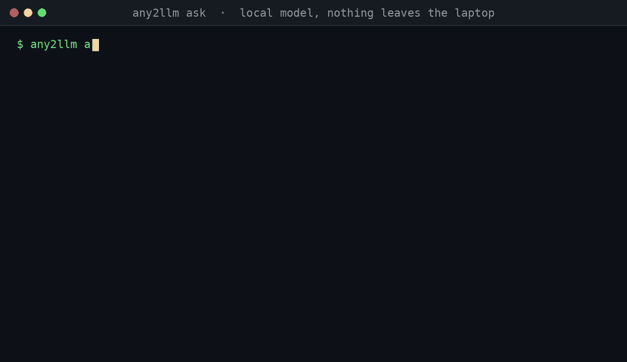

# any2llm

**Ask your documents. Get answers with page numbers, and proof that every quote is really on that page.**

AI chats cite "page 12" when the sentence is on page 14, or quote a "14-day" deadline your contract never mentions.
any2llm reads a folder of PDFs, Word, Excel, PowerPoint, and EPUB files on your computer, answers with a local
model, and then checks every quote against the original page.



```sh
pipx install any2llm             # or: uvx any2llm …
ollama pull qwen3:4b-instruct    # any local model works
any2llm ask demo                 # ask a question about the bundled sample files
```

[](https://pypi.org/project/any2llm/)
[](pyproject.toml)
[](https://registry.modelcontextprotocol.io/v0/servers?search=io.github.ahmetemreapo/any2llm)
[](#claude-code-plugin)
[](https://github.com/ahmetemreapo/any2llm/actions/workflows/platforms.yml)
[](LICENSE)

[Local models](#ask-with-a-local-model) · [Check any chat's answer](#check-an-answer-from-any-chat) · [Claude Code](#claude-code-plugin) · [MCP](#use-it-in-claude-desktop-cursor-and-other-mcp-apps) · [Examples](examples/README.md) · [Türkçe](README.tr.md)

## Pick your way in

| You use | Run | You get |
| --- | --- | --- |
| Ollama, LM Studio, or llama.cpp | `any2llm ask ./docs "When is payment due?"` | An answer from your local model, with every quote checked |
| ChatGPT, Claude, Gemini, or any chat | Copy its answer, then `any2llm check ./docs` | Each quote marked as found, on another page, or not in your files |
| Claude Code | `/plugin install any2llm --marketplace ahmetemreapo/any2llm` | Claude reads your folder and checks its own citations before it answers |
| Claude Desktop, Cursor, other MCP apps | `uvx any2llm mcp ~/Documents` | Tools to list, read, and check documents |
| Any chat, by hand | `any2llm ./docs` | Numbered Markdown attachments and a citation prompt on your clipboard |
| Scripts | `any2llm ./docs --stdout \| llm "List every deadline"` | One Markdown stream on standard output |

## Why it's different

- **Every quote is checked.** A citation is a short quote plus its source, like `"exact words" [contract.pdf, p. 7]`. any2llm looks for the quote on that page. If it's on page 9, you're told it's on page 9. If a number changed, it fails, even when the rest of the sentence matches.
- **The model reads the whole document.** Local "chat with your files" tools usually split documents into chunks and send the model only the few chunks that look relevant, and the page numbers often get lost along the way. any2llm sends the model the full text with `<page number="N">` tags. When a folder is bigger than the model's context, it reads the folder in parts and collects quotes from each part. Each collected quote is matched back to the full sentence it came from in your file, so the final answer is built from real sentences, not from the model's paraphrases.
- **It uses the context your model really has.** Ollama gives models only [4k tokens of context on GPUs with less than 24 GB](https://docs.ollama.com/context-length) unless the request asks for more. any2llm sets the context size for each request and sizes the parts to fit, so the start of a long document doesn't silently drop out.
- **Nothing leaves your computer.** Text extraction, OCR, the model, and the check all run locally. If you point `--api` at a remote server, any2llm tells you before it sends anything.
- **It reads mixed folders.** PDF (with optional OCR for scans), Word, PowerPoint, Excel (values and formulas), EPUB, HTML, CSV, Markdown, and source code. Credential files are skipped, and broken or encrypted files are reported instead of crashing the run.
- **It speaks 11 languages.** The terminal and the prompts come in English, 中文, हिन्दी, Español, Français, العربية, বাংলা, Português, Русский, اردو, and Türkçe.

## Ask with a local model

```sh
any2llm ask ./contracts "Which contracts renew automatically, and with how much notice?"
any2llm ask ./course-notes -r                 # no question: keep asking in a loop
any2llm ask demo                              # bundled sample: slides, a PDF, a Word file, and a spreadsheet
```

any2llm finds a model server on this computer by itself: Ollama on port 11434, LM Studio on 1234, or llama.cpp on 8080. It uses the most recently installed chat model unless you pass `--model`.

| Option | Effect |
| --- | --- |
| `--model NAME` | Choose the model, for example `--model qwen3:8b` |
| `--context TOKENS` | Context size per request (Ollama default here: 8192, capped at the model's maximum) |
| `--api URL` | Any OpenAI-compatible server, for example `--api http://localhost:1234/v1`. Set `ANY2LLM_API_KEY` if it needs a key. |
| `-r`, `--exclude GLOB`, `--ocr` | Same as for packing: subfolders, skipped paths, and OCR for scanned pages |
| `--no-check` | Skip the citation check |

**Which model?** Small instruction models follow the quote format well. On a laptop RTX 4050 (6 GB), `qwen3:4b-instruct` answered questions about the 17-page example lease in 5 to 7 seconds from the command line. [`examples/eval_lease.py`](examples/eval_lease.py) asks it five questions with 9 expected facts, once with an 8,192-token context and once with 2,048 tokens, where it has to read the lease in three parts. In three runs of both settings, every answer had all 9 facts and all 9 citations passed the check. Thinking models also work, but they're slower: any2llm keeps their reasoning out of the answer.

## Check an answer from any chat

You don't have to change chats to get checked citations.

1. Run `any2llm ./docs`. The prompt it puts on your clipboard asks the chat for quotes in the `"exact words" [file, p. N]` format.
2. Attach the files and paste the prompt into ChatGPT, Claude, Gemini, or a local chat.
3. Copy the answer and run `any2llm check ./docs`. The clipboard is read automatically. You can also pass a file (`any2llm check ./docs answer.md`) or pipe the answer in.

```text
✗  2 of 4 citations match the original sources
  ✗ [lease-agreement.pdf, p. 12] quote is on page 14, not the cited page
  ✗ [lease-agreement.pdf, p. 6] quote not found in this source
      "The deposit is refunded within 14 days after the Tenant returns the keys"
  ✓ [lease-agreement.pdf, p. 8] quote found where cited
  ✓ [house-rules.txt] quote found where cited
```

The exit code is 0 only when every citation is confirmed, and `--json` prints a machine-readable report. That makes the check easy to use in scripts and CI.

<details>
<summary>What counts as a match</summary>

- Case, line breaks, hyphenation, curly quotes, dashes, and table pipes are ignored. An ellipsis (`…`) inside a quote may skip text.
- A longer quote with a small wording difference is reported as *found with small differences*. Any changed number, date, or amount fails.
- Citations may use square brackets or parentheses, list several sources (`[a.pdf, p. 2; b.xlsx]`), use page ranges (`pp. 3–5`), or use the page abbreviations of other languages (`s. 3`, `стр. 4`, `第3页`).
- A claim with a source but no quote is listed as *no quote to check*. The check confirms that quotes exist where they're cited. It does not judge reasoning or arithmetic.

</details>

## Claude Code plugin

```text
/plugin install any2llm --marketplace ahmetemreapo/any2llm
```

On older Claude Code versions, run `/plugin marketplace add ahmetemreapo/any2llm` and then `/plugin install any2llm@any2llm`.

Then ask in plain words, such as *"What does the lease in ./lease say about pets and moving out?"* The skill extracts the folder with any2llm, drafts an answer with quotes, runs `any2llm check` on the draft, fixes anything that fails, and ends with a line saying that every quote was checked. In a test run on the example lease, Claude wrote 10 citations and all 10 passed the check. The skill needs `any2llm`, `uvx`, or `pipx` on your PATH.

The skill follows the [Agent Skills](https://agentskills.io) format, so you can also copy [`plugin/skills/any2llm`](plugin/skills/any2llm/SKILL.md) into another agent that supports skills.

## Use it in Claude Desktop, Cursor, and other MCP apps

`any2llm mcp` runs a local, read-only [Model Context Protocol](https://modelcontextprotocol.io) server with three tools: `list_documents`, `read_documents` (Markdown with page tags, in batches), and `check_citations`. The server tells the model to check its draft before answering, and it never reads outside the folder you give it.

```sh
claude mcp add any2llm -- uvx any2llm mcp ~/Documents
```

<details>
<summary>Claude Desktop, Cursor, Windsurf, and other apps with an <code>mcpServers</code> file</summary>

```json
{
  "mcpServers": {
    "any2llm": {
      "command": "uvx",
      "args": ["any2llm", "mcp", "/Users/you/Documents"]
    }
  }
}
```

If the app can't find `uvx`, use its full path (`which uvx` on macOS and Linux, `where uvx` on Windows). With a pipx install, use `"command": "any2llm"` and `"args": ["mcp", "/Users/you/Documents"]`. Add `--ocr` or `--ocr-lang tur` after the folder to read scanned pages.

</details>

## Attach files to any chat

```sh
any2llm "./documents"          # keep the quotes if the path has spaces
any2llm ./documents -r         # include subfolders
any2llm ./documents --task "Find every payment deadline and who owes it"
```

1. On the first run, choose your language, a detail level, and whether to open the output folder.
2. Select files, then attach the numbered Markdown files from `_llm_pack/` and paste the prompt (also saved as `PROMPT.txt`).
3. If there are several batches, follow the upload order the terminal prints and send the continuation word between them in the same chat.
4. Copy the final answer and run `any2llm check ./documents`.

Ready-made output is in [examples/](examples/README.md) if you want to try a chat without installing anything.

## Use it in scripts and pipes

`--stdout` prints one unsplit pack to standard output and sends progress and warnings to standard error. It selects every readable file and writes nothing to disk.

```sh
any2llm ./contracts --stdout | claude -p "Which contract renews automatically? Cite the PDF page."
any2llm ./papers -r --stdout | llm "Compare the sample sizes across these papers"
any2llm ./notes --stdout > notes-pack.md
```

<details>
<summary>All command-line options</summary>

| Option | Effect |
| --- | --- |
| `-r`, `--recursive` | Include subfolders |
| `-y`, `--yes` | Select every readable file without prompting |
| `--stdout` | Print one unsplit pack to standard output |
| `--task TEXT` | Put your question into the generated prompt |
| `--max-tokens INT` | Token budget per batch |
| `--lang CODE` | Terminal and prompt language: `en`, `zh`, `hi`, `es`, `fr`, `ar`, `bn`, `pt`, `ru`, `ur`, `tr` |
| `--ocr`, `--ocr-lang LANG` | OCR PDF pages without extractable text (for example `eng+tur`) |
| `--exclude GLOB` | Skip matching paths (repeatable). Root `.gitignore` rules also apply. |
| `-o DIR`, `--output DIR` | Output folder (default `_llm_pack`) |
| `--details` | List every skipped file |
| `--plain` | Numbered menus instead of checkboxes |
| `--no-open`, `--no-clipboard` | Don't open the output folder, or don't copy the prompt |
| `--include-sensitive` | Include files that look like credentials |
| `ask`, `check`, `mcp`, `setup`, `demo` | Ask a local model, check an answer, start the MCP server, change settings, or run the demo |
| `--version` | Print the version |

Full reference: [docs/SPEC.md](docs/SPEC.md#command-line-options)

</details>

## What gets extracted

| Format | What you get |
| --- | --- |
| PDF | Text per physical page in `<page>` tags. Pages without text are flagged, and optional OCR can read them. |
| Word (`.docx`) | Paragraphs and tables in document order |
| PowerPoint (`.pptx`) | Text and tables, slide by slide |
| Excel (`.xlsx`) | Visible sheets as tables, with cached values and formulas |
| EPUB | Chapters in reading order. DRM-protected books are skipped. |
| HTML | Saved pages as readable text with headings, lists, and tables. Templates stay as code. |
| Text and code | Markdown, CSV, JSON, YAML, and source code, with whitespace preserved |

Charts, images, and page layout aren't extracted. Check the original when an answer depends on a visual.

## Privacy, limits, and OCR

- Privacy: extraction, OCR, local models, and the check all run on your computer. tiktoken may download its vocabulary on first use. Common credential files (`*.pem`, `id_rsa`, `credentials*`, …) are skipped, and likely secrets in extracted text are flagged but left in the output, so **review it before uploading it to a cloud chat**. See the [security policy](SECURITY.md).
- Limits: up to 32 MiB per file, 500 pages per PDF, 128 MiB uncompressed per Office or EPUB archive, and 120 seconds of extraction per file. Your chat's attachment and context limits still apply.

<details>
<summary>Set up OCR for scanned PDFs</summary>

Install Poppler (`pdftoppm`) and [Tesseract](https://tesseract-ocr.github.io/tessdoc/Installation.html) with the language data you need, and add their folders to `PATH` as absolute paths. Use `--ocr` for English or `--ocr-lang` to choose installed languages, for example `--ocr-lang eng+tur`. OCR only runs on PDF pages without usable text, and recognized pages are marked in the batch. Check important names and numbers against the scan.

</details>

## FAQ

**Can't ChatGPT or Claude read my PDFs already?** Yes, and you can keep using them. `any2llm check` shows you which of their quotes are really in your files and on which page. any2llm also covers what most chats can't take in one go: dozens of files, Excel formulas, EPUBs, scanned pages, and models that run offline.

**Isn't this just RAG?** No vector database and no embeddings. The model reads the whole text, part by part if needed, and the answer is held to quotes you can check.

**Does a ✓ mean the answer is right?** It means the quoted words are on the cited page. Read the quote, and look at any conclusion the model drew from it, such as a total it added up.

## Contributing

Bug reports, examples, translations, and code are all welcome. Start with the [contributing guide](CONTRIBUTING.md) or an issue labeled [good first issue](https://github.com/ahmetemreapo/any2llm/labels/good%20first%20issue).

If any2llm caught a wrong citation for you, a star helps other people find it.

## License

[MIT](LICENSE)
