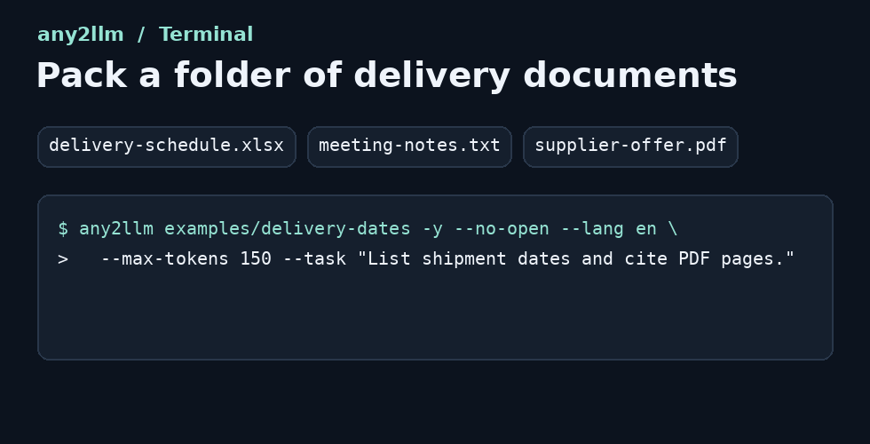

# any2llm

**PDF, Office, e-kitap ve kod dosyalarıyla dolu bir klasörü yapay zekâya hazır Markdown’a dönüştür. PDF sayfa numaraları korunur, böylece her atıfı kontrol edebilirsin.**

Üç şekilde kullanabilirsin: çıktıyı herhangi bir yapay zekâ sohbetine ekle, bir komut satırı aracına aktar ya da Claude, Cursor ve diğer MCP uygulamalarını doğrudan belgelerine bağla.

[](https://pypi.org/project/any2llm/)
[](pyproject.toml)
[](LICENSE)
[](https://github.com/ahmetemreapo/any2llm/actions/workflows/platforms.yml)

[English](README.md)



[Terminal kaydı](examples/delivery-dates-demo.gif)

## Hızlı başlangıç

[uv](https://docs.astral.sh/uv/getting-started/installation/) ile kalıcı kurulum yapmadan dene:

```sh
uvx any2llm ./belgeler
```

Ya da [pipx](https://pipx.pypa.io/stable/how-to/install-pipx.html) ile kalıcı olarak kur (Python 3.11 veya üstü):

```sh
pipx install any2llm
```

| Kullanım | Komut | Sonuç |
| --- | --- | --- |
| Sohbet ekleri | `any2llm ./belgeler` | Numaralı Markdown dosyaları ve panoya kopyalanan atıf istemi |
| Yönlendirme (pipe) | `any2llm ./belgeler --stdout \| llm "Tüm son tarihleri listele"` | Standart girdiden okuyan her araç için tek bir Markdown akışı |
| MCP sunucusu | `claude mcp add any2llm -- uvx any2llm mcp ~/Documents` | Claude, Cursor ve diğer MCP uygulamaları dosyalarını istediğinde okur |

[Windows, macOS ve Linux için kurulum yardımı](docs/install.md)

## Neden any2llm?

- **Kontrol edilebilir atıflar.** Her PDF parçası fiziksel sayfa numarasını bir `<page>` etiketinde taşır. Metni çıkarılamayan sayfalar işaretlenir. İsteğe bağlı yerel OCR taranmış sayfaları okuyabilir.
- **Karışık klasörler tek seferde.** PDF, Word, PowerPoint, Excel (değerler ve formüller), EPUB, HTML, CSV, Markdown, metin ve kaynak kod.
- **Her bağlam penceresine sığar.** Token bütçeli paketler ve sohbeti bunlarda sırayla gezdiren hazır bir istem.
- **Yerel ve dikkatli.** Metin çıkarma senin bilgisayarında çalışır. Kimlik bilgisi dosyaları atlanır, olası gizli anahtarlar işaretlenir. Bozuk, şifreli veya ikili dosyalar çalışmayı çökertmek yerine raporlanır.
- **11 dil** desteği: terminal ve üretilen istemler için.

## Kimler için?

| Alan | Örnek kullanım |
| --- | --- |
| Ofis ve finans | Tedarikçi teklifindeki tarihleri hesap tablosuyla karşılaştır. [Teslimat tarihleri örneğine](#teslimat-tarihleri-iş-örneği) bak. |
| Hukuk | Sözleşme taslaklarındaki maddeleri karşılaştır, alıntıları orijinal PDF’te kontrol et. |
| Araştırma | Makalelerdeki yöntemleri özetle, bir tanımı kaynak sayfasından kontrol et. |
| Yazılım | Bir yapılandırma ayarının kaynak kodda ve teknik notlarda nasıl kullanıldığını sor. |
| Kitaplar ve uzun metinler | Bir EPUB’ı veya kaydedilmiş web sayfalarını paketle, bölüm bölüm özet iste. |
| Öğrenciler | Ders slaytlarından, okuma metinlerinden ve çalışma belgelerinden bir alıştırma sorusu çıkar. [Vizeye hazırlık örneğine](#öğrenci-örneği-vizeye-hazırlık) bak. |

## Kurmadan dene

GitHub eki metin olarak açarsa dosya görünümünün üstündeki indirme okuyla (↓) orijinal `.md` dosyasını kaydet.

### Teslimat tarihleri: iş örneği

Pakette bir tedarikçi teklifi (PDF), teslimat çizelgesi (Excel) ve toplantı notu (düz metin) var. [Kaynak dosyalara göz at](examples/delivery-dates/).

1. [Teslimat tarihleri ekini](examples/delivery-dates-pack/batch_01_of_1.md?plain=1) aç, **↓** simgesiyle indir ve yapay zekâ sohbetine ekle.
2. Şu soruyu yapıştır ve ekle birlikte gönder.

   > Pilot ve ana sevkiyat tarihlerini listele. Her tarih için Excel sayfasına ve orijinal PDF’in sayfasına atıf yap. Metni okunamayan sayfa varsa belirt.

3. Tarihleri [orijinal tedarikçi teklifinin](https://raw.githubusercontent.com/ahmetemreapo/any2llm/main/examples/delivery-dates/supplier-offer.pdf#page=1) 1. ve 3. sayfalarından kontrol et.

<details>
<summary>Beklenen cevap</summary>

| Sevkiyat | Teslimat tarihi | Kaynaklar |
| --- | --- | --- |
| Pilot | 12 Mart 2027 | `delivery-schedule.xlsx`, **Schedule** sayfası ve `supplier-offer.pdf`, **1. sayfa** |
| Ana | 26 Mart 2027 | `delivery-schedule.xlsx`, **Schedule** sayfası ve `supplier-offer.pdf`, **3. sayfa** |

Paket, metni görsel içinde olduğu için 2. sayfayı işaretler. Navlun notunu okumak için orijinal sayfayı aç.

</details>

### Öğrenci örneği: vizeye hazırlık

Araştırma Yöntemleri için hazırlanan dört dosya (PDF, PowerPoint, Word ve Excel) tek eke sığıyor. Komut satırı aracı [sohbet isteminin tamamını](examples/midterm/tr/PROMPT.txt) da üretir.

1. [Vizeye hazırlık ekini](examples/midterm/tr/batch_01_of_1.md?plain=1) aç, **↓** simgesiyle indir ve yapay zekâ sohbetine ekle.
2. Şu soruyu yapıştır ve ekle birlikte gönder.

   > Ölçüm planı hangi araştırma desenine uyuyor? Her sınıfta neyin ölçüldüğünü Excel sayfasına, desenin tanımını da orijinal PDF’in sayfasına atıf yaparak açıkla.

3. Tanımı [orijinal PDF’in 2. sayfasından](https://raw.githubusercontent.com/ahmetemreapo/any2llm/main/src/any2llm/demo_assets/tr/ara%C5%9Ft%C4%B1rma-desenleri.pdf#page=2) kontrol et. PDF ilk sayfada açılırsa ikinci sayfaya kaydır.

<details>
<summary>Beklenen cevap</summary>

Plan, **eşdeğer olmayan karşılaştırma gruplu ön test–son test yarı deneysel desene** uyuyor. Rastgele atama yapılmamış iki mevcut sınıfa etkinlikten önce ve sonra aynı 10 soruluk terim testi uygulanıyor. Sekiz dakika boyunca A sınıfı terimleri hafızadan hatırlıyor, B sınıfı ise terimleri yeniden okuyor. `ölçüm-planı.xlsx` dosyasındaki **Ölçüm Planı** sayfasına ve `araştırma-desenleri.pdf` dosyasının **2. sayfasına** bak.

</details>

Örnek günlük işine uyuyorsa repoya yıldız vermeyi düşünebilirsin.

## Diğer araçlardan farkı ne?

any2llm PDF sayfa numaralarını sohbet eklerinde korur, kaynak atfı isteyen ve çok parçalı sohbette sırayı tarif eden bir istem üretir. Tire, hücrede özellik bilgisi verilmediğini gösterir.

| Araç | PDF sayfa numaraları | Çıktıyı bölme | OCR | Yerel işleme | Örnek girdiler | Sohbet talimatları |
| --- | --- | --- | --- | --- | --- | --- |
| **any2llm** | Markdown’da sayfa etiketleri | Token bütçesine göre Markdown parçaları | Okunabilir metni olmayan PDF sayfaları için isteğe bağlı Tesseract | Yerel metin çıkarma ve OCR | PDF, DOCX, PPTX, XLSX, EPUB, HTML, CSV, metin, kod | Atıf istemi ve devam mesajları üretir |
| MarkItDown | — | — | OCR eklentisiyle görsel işleyen model | Yerel dosya dönüştürme mümkün | PDF, Word, PowerPoint, Excel, CSV, HTML | — |
| Docling | Belgenin kaynak bilgisine kaydedilen sayfa numaraları | Ayarlanabilir token bütçesiyle JSONL parçaları | Yapılandırılabilir OCR motorları | Yerelde çalıştırılabilir | PDF, DOCX, PPTX, XLSX, HTML, görseller | — |
| Pandoc | — | HTML çıktısını belgenin bölümlerine göre ayırır | — | Yerel komut satırı aracı | Markdown, HTML, LaTeX, DOCX, EPUB | — |
| Repomix | — | Boyuta göre numaralı çıktı dosyaları | — | Yerel komut satırı aracı | Kod ve Markdown gibi repo dosyaları | Kullanıcının yazdığı talimat dosyasını ekler |

Resmî kaynaklar

- MarkItDown ([proje README’si](https://github.com/microsoft/markitdown/blob/main/README.md), [OCR eklentisi](https://github.com/microsoft/markitdown/tree/main/packages/markitdown-ocr))
- Docling ([biçimler ve parçalara bölme](https://docling-project.github.io/docling/usage/supported_formats/), [sayfa kaynak bilgisi](https://docling-project.github.io/docling/reference/docling_document/#docling_core.types.doc.ProvenanceItem), [OCR motorları](https://docling-project.github.io/docling/getting_started/installation/#ocr-engines), [yerel çalışma](https://docling-project.github.io/docling/))
- Pandoc ([girdi biçimleri](https://pandoc.org/MANUAL.html#option--from), [parçalı HTML çıktısı](https://pandoc.org/MANUAL.html#chunked-html))
- Repomix ([hızlı başlangıç](https://repomix.com/guide/), [çıktı bölme](https://repomix.com/guide/configuration), [özel talimatlar](https://repomix.com/guide/custom-instructions))

## Kendi klasörünü hazırla

Örnekteki yolu kendi klasörünle değiştir. Boşluk içeren yolları tırnak içinde yaz.

```sh
any2llm "./belgelerim" --lang tr
```

1. İlk çalıştırmada tercihlerini belirle ve dahil edilecek dosyaları seç.
2. `_llm_pack` çıktı klasöründeki numaralı Markdown dosyalarını ekle. Üretilen `PROMPT.txt` metnini sohbete yapıştır.
3. Birden fazla parça varsa terminalin gösterdiği yükleme sırasını izle. İncelenecek parça kaldığında devam sözcüğünü aynı sohbete yaz. Modelin davranışı değişebilir. Model sonraki parçaya geçmezse son mesajını parçanın dosya adını belirterek yeniden gönder ve dosyayı daha önce yüklemediysen ekle. Önemli PDF atıflarını orijinal belgede kontrol et.

Alt klasörler için `-r`, parça başına token bütçesi için `--max-tokens`, kendi sorun için `--task`, atlanan tüm dosyaları görmek için `--details` kullan. Sohbet hizmetinin token hesabı farklı olabilir.

Terminal ve üretilen istemler `--lang` ile 11 dili destekler (`en`, `zh`, `hi`, `es`, `fr`, `ar`, `bn`, `pt`, `ru`, `ur`, `tr`). [Komut satırı seçeneklerine](docs/SPEC.md#command-line-options) bak.

Kurulumla gelen vize örneğini `any2llm demo --lang tr --no-open` ile çalıştır. Komut yeni bir çıktı klasörünün yolunu gösterir.

## Claude, Cursor ve diğer MCP uygulamalarına bağla

`any2llm mcp`, stdio üzerinden yerel bir [Model Context Protocol](https://modelcontextprotocol.io) sunucusu çalıştırır. Yapay zekâ uygulamasına iki salt okunur araç verir: `list_documents` bir klasörün içeriğini gösterir, `read_documents` ise çıkarılan Markdown’ı PDF sayfa etiketleriyle döndürür. İçerik büyükse paketlere böler. Sunucu yalnızca verdiğin klasörün içini okur.

**Claude Code**

```sh
claude mcp add any2llm -- uvx any2llm mcp ~/Documents
```

**Claude Desktop, Cursor ve `mcpServers` dosyası kullanan diğer uygulamalar**

```json
{
  "mcpServers": {
    "any2llm": {
      "command": "uvx",
      "args": ["any2llm", "mcp", "/Users/sen/Belgeler"]
    }
  }
}
```

Sonra şöyle bir şey sor: *“Sözleşmeler klasörünü oku ve her fesih maddesini PDF sayfasıyla listele.”* Uygulama `uvx` komutunu bulamazsa tam yolunu kullan (macOS ve Linux’ta `which uvx`, Windows’ta `where uvx`) ya da pipx ile kurup `"command": "any2llm", "args": ["mcp", "…"]` yaz. Taranmış sayfaları okumak için klasörden sonra `--ocr` veya `--ocr-lang tur` ekle.

## Diğer araçlara aktar

`--stdout`, bölünmemiş tek paketi standart çıktıya yazar. İlerleme ve uyarılar standart hataya gider. Okunabilir tüm dosyaları seçer ve diske bir şey yazmaz.

```sh
any2llm ./sozlesmeler --stdout | claude -p "Hangi sözleşme otomatik yenileniyor? PDF sayfasını belirt."
any2llm ./makaleler -r --stdout | llm "Bu makalelerdeki örneklem büyüklüklerini karşılaştır"
any2llm ./notlar --stdout | pbcopy          # macOS panosu (Linux: wl-copy veya xclip, Windows: clip)
any2llm ./notlar --stdout > notlar-paketi.md
```

## Sınırlar, gizlilik ve OCR

- **Metin çıkarma.** Paketler PDF metnini ve fiziksel sayfa numaralarını, Word ve PowerPoint metin ve tablolarını, görünür Excel sayfalarındaki değer ve formülleri, okuma sırasına göre EPUB bölümlerini, kaydedilmiş HTML sayfalarındaki okunabilir metni, metin ve kodu içerir. HTML şablonları (`{{ }}` veya `` içerenler) ve parçalı HTML dosyaları kaynak kod olarak kalır. DRM korumalı EPUB’lar atlanır. Grafikler, görseller ve sayfa düzeni kaybolabilir. Terminal, metni okunamayan veya kısmen okunan PDF sayfalarını gösterir. Cevap önemli bir ayrıntıya veya görsele dayanıyorsa orijinal belgeyi aç.
- **Dosya sınırları.** Kaynak başına 32 MiB, PDF başına 500 sayfa, açılmış Office arşivi başına 128 MiB ve metin çıkarma için dosya başına 120 saniye. Okunamayan, şifreli ve desteklenmeyen dosyalar bildirilip atlanır. Sohbetin ek ve bağlam sınırları ayrıca geçerlidir.
- **Gizlilik.** Metin çıkarma ve OCR yerelde çalışır. tiktoken ilk kullanımda sözlüğünü indirebilir. Sohbete yüklemeden önce çıktıyı gözden geçir. Araç kimlik bilgisi içerebilecek yaygın dosya adlarını atlar ve çıkardığı metinde tanıdığı bazı anahtar biçimlerini bildirir. Çıkarılan metin çıktıda kalır. [Güvenlik politikasına](SECURITY.md) bak.
- **OCR.** Poppler’i (`pdftoppm`) ve Tesseract’ı gerekli dil verileriyle birlikte kur. Kurulum klasörlerini tam yollarıyla `PATH` değişkenine ekle. İngilizce için `--ocr` kullan. Sohbet isteminin dilinden bağımsız olarak kurulu dilleri seçmek için `--ocr-lang` kullan. OCR, okunabilir metni olmayan PDF sayfalarını işlemeyi dener ve metni tanınan sayfaları pakette işaretler. Önemli adları ve sayıları orijinal taramada kontrol et. [Tesseract kurulum rehberi](https://tesseract-ocr.github.io/tessdoc/Installation.html)
